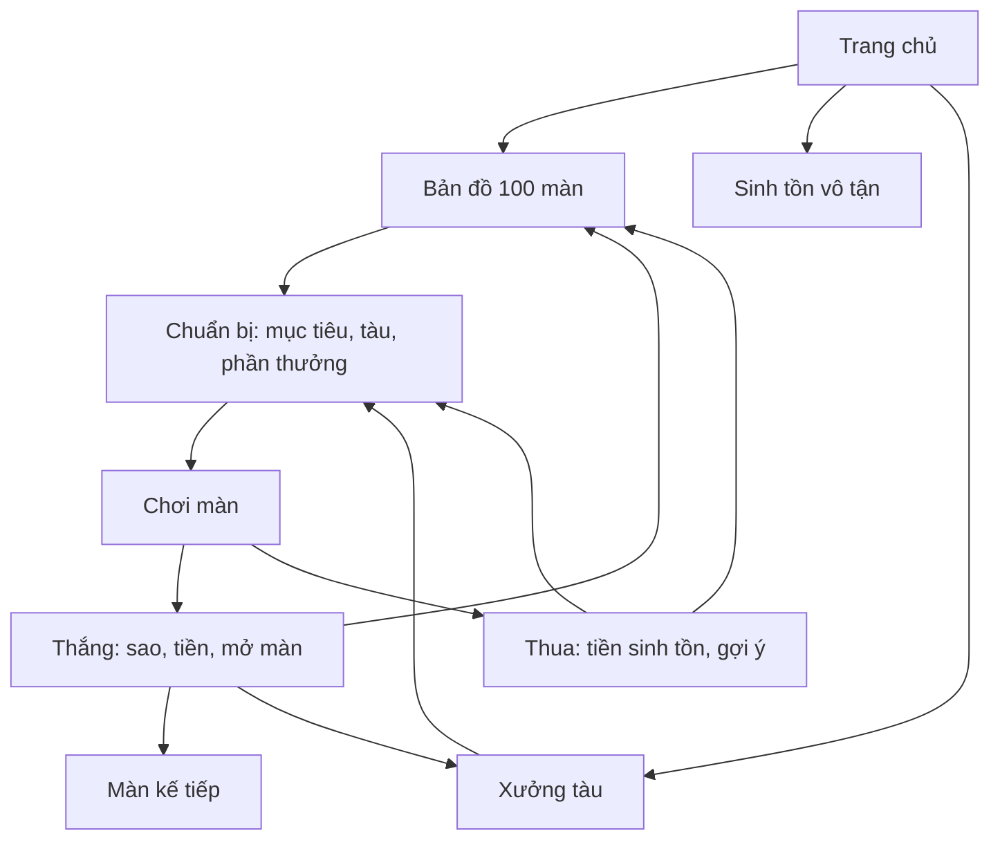

# METEOR DASH 2.0 — HẠM ĐỘI & HÀNH TRÌNH 100 MÀN

> **Trạng thái: TÀI LIỆU THIẾT KẾ, CHƯA TRIỂN KHAI VÀO APP.**
>
> Ngày lập: **17/10/2026**. Nền hiện tại: **Meteor Dash 1.3**, Android Kotlin + Jetpack Compose + Canvas, offline, 20 ngôn ngữ.
>
> Theo yêu cầu: làm tài liệu thiết kế trước. Giá, phần thưởng, thời lượng và thông số mới dưới đây là **giá trị khởi điểm để playtest**, chưa phải số liệu đã kiểm chứng trong bản chơi được.

## 1. Mục tiêu và phạm vi

Biến game né thiên thạch vô tận thành hành trình có đích: sống sót để kiếm tín dụng, mua tàu với cách chơi khác nhau, vượt từng cửa ải và chinh phục bản đồ 100 màn.

1. **Tàu đáng sở hữu:** khác hình dáng, thông số, nội tại và đánh đổi, không chỉ thay màu.
2. **Lộ trình rõ:** 10 chương × 10 màn; nhìn được màn đã qua, sao, phần thưởng và chặng tiếp theo.
3. **100 kịch bản có điểm riêng:** khác quyết định chơi, mục tiêu hoặc cách bố trí cơ chế, không chỉ tăng tốc độ/mật độ.
4. **Thất bại vẫn có tiến bộ:** lượt kết thúc hợp lệ có tiền sinh tồn; có thể quay lại màn cũ hoặc vô tận để kiếm tiền mua tàu.

Phạm vi thiết kế: 12 tàu; 100 màn; 10 cửa ải trùm; bản đồ, chuẩn bị, xưởng, thắng/thua; lưu sao và mở khóa; migration từ 1.3; 20 ngôn ngữ; offline. Không cần tài khoản hoặc tải màn từ mạng, không thêm tiền thật hay đồng tiền thứ hai.

“Mỗi màn khác nhau” không nghĩa là viết 100 engine. Dùng chung cơ chế nhưng từng màn phải có một quyết định nổi bật: chuyển làn lúc nào, bảo vệ ai, chọn đường nào, dùng hay giữ xung, ưu tiên vật phẩm nào hoặc đọc tín hiệu nào. Đổi màu, seed hay số giây không đủ để tính là điểm riêng.

## 2. Vòng lặp trải nghiệm



| Chế độ | Mục tiêu | Kết thúc | Thành tích |
|---|---|---|---|
| Sinh tồn vô tận | Sống lâu, ghi điểm, kiếm tiền | Hết giáp | Kỷ lục vô tận riêng |
| Chiến dịch | Mục tiêu cố định của từng màn | Thắng, hết giáp, mục tiêu bảo vệ bị phá hoặc hết hạn | Sao và thành tích từng màn |

Không trộn kỷ lục hai chế độ vì luật và tiếp tế khác nhau. Nhịp màn: xem mục tiêu → chọn tàu → đếm ngược 3s → pha giới thiệu → thử thách → kết thúc → lưu kết quả → đi tiếp. Màn thường 30–90s; trùm có giới hạn 90–180s. Màn hoàn tất sớm không nhận điểm sinh tồn cho thời gian chưa chơi.

## 3. Điều khiển, vật cản và công bằng

### 3.1 Điều khiển

- Giữ màn dọc, vùng logic **360 × 800**, kéo ngang tương đối, không nhảy tới chỗ chạm.
- Một nút chủ động chung: **PHÁT XUNG**. Nội tại tàu tự kích hoạt theo điều kiện rõ ràng.
- Thu thập, hộ tống, mở cổng và đánh trùm đều dùng vị trí tàu và xung. Không thêm kéo dọc/nhiều nút nhỏ.
- Tàu có vận tốc ngang tối đa riêng. Cần chuyển từ bám tọa độ tức thời bản 1.3 sang chuyển động giới hạn tốc độ, vẫn dùng swept collision.
- Tùy chọn độ nhạy kéo 0,75× / 1× / 1,25× không thay giới hạn vận tốc tàu.

### 3.2 Phân loại đối tượng

| Loại | Hành vi | Xung | Dấu hiệu |
|---|---|---|---|
| Đá thường | Rơi, chéo, bật mép theo lịch | Phá được | Nâu/xám, viền đá |
| Đá phân mảnh | Vỡ theo cảnh báo, chỉ 1 thế hệ mảnh | Phá trước khi vỡ | Vết nứt sáng |
| Mìn | Trôi/đứng, đếm trước khi nổ | Tắt trong bán kính | Tâm nổ + vòng đếm |
| Drone | Tuyến di chuyển và nhịp bắn định trước | Phá trong bán kính | Thân máy đỏ |
| Tia quét | Quét lane có cảnh báo | Không xóa tia; né khe hoặc dùng bảo vệ xung khi cho phép | Vạch chấm → liền |
| Trường môi trường | Gió, băng, nhiễu nạp | Không xóa trường | Viền vùng + ký hiệu |
| Cổng | Cửa sổ vị trí/điều kiện | Có loại nhận xung | Khung + điều kiện |
| Lõi trùm | Chỉ nhận đòn khi mở giáp | Xung trúng nếu trong tầm | Thanh lõi + vòng mở |

### 3.3 Giao kèo công bằng

- Mọi đường bắt buộc phải khả thi với **Nova–01** và tàu chậm nhất được phép dùng.
- Khe an toàn cơ bản rộng tối thiểu **90 đơn vị**, đo giữa mép nguy hiểm, xét thêm bán kính tàu; không chỉ kiểm khoảng trống ở đầu màn hình.
- Cảnh báo tối thiểu 1,6s, đồng thời đáp ứng `warning >= requiredDistance / minShipSpeed + 0,5s dự phòng`.
- Kiểm tra đường đi **theo thời gian**, từ vị trí hiện tại tới khe tại lúc vật tới hàng tàu.
- Đồ bắt buộc sinh theo lịch, có đường tới; số cơ hội thu thập ít nhất 150% mục tiêu, trừ chuỗi có cơ chế lặp.
- Cửa sổ cần xung phải đủ nạp cho tàu nạp chậm nhất. Bỏ lỡ được chờ chu kỳ sau đến hết hạn.
- Không ép mua tàu, đạt 3 sao cũ hay chịu sát thương để qua cửa.
- Không làm tối hoàn toàn hitbox hoặc chỉ dùng màu để truyền thông tin thiết yếu.
- Giảm chuyển động giữ nguyên cảnh báo và tính công bằng. Ra nền rồi trở lại luôn tạm dừng.

## 4. Hạm đội 12 tàu

### 4.1 Quy tắc mua

Tín dụng đến từ những lượt sinh tồn và vượt màn đã kết thúc/lưu hợp lệ. **Giá bị trừ khi mua**, không chỉ là mốc tổng tiền từng kiếm. Mua một lần; đổi giữa tàu đã sở hữu miễn phí. Không đổi tàu giữa lượt.

Thông số là cơ bản trước nâng cấp tài khoản: hitbox theo đơn vị logic; vận tốc đơn vị/giây; hồi năng lượng/giây. Năng lượng tối đa 100, xung nền 180 nếu không ghi khác.

| ID | Tàu / dáng máy bay | Giá | Giáp | Hitbox | Vận tốc | Hồi NL | Nội tại / mạnh | Đánh đổi |
|---|---|---:|---:|---:|---:|---:|---|---|
| S01 | **Nova–01** — cánh tam giác cyan | 0 | 3 | 12 | 720 | 3,0 | Cân bằng, không luật phụ; chuẩn kiểm chứng mọi màn | Không chuyên môn hóa |
| S02 | **Swift** — tiêm kích cánh quét | 250 | 2 | 10 | 900 | 3,0 | Chuyển làn nhanh, thân nhỏ | Ít giáp |
| S03 | **Bulwark** — máy bay giáp rộng | 650 | 5 | 15 | 600 | 2,5 | Chịu nhiều va chạm lẻ | To, chậm, nạp chậm |
| S04 | **Scavenger** — vận tải hai càng | 1.200 | 3 | 13 | 680 | 3,0 | Hút vật phẩm tùy chọn trong 45 đơn vị quanh hàng tàu | Không tự hút đồ bắt buộc/cổng; thân lớn |
| S05 | **Volt** — hai động cơ vàng | 2.000 | 2 | 11 | 780 | 4,2 | Nạp thụ động nhanh | Giáp thấp; pin thường chỉ nạp 15 thay vì 20 |
| S06 | **Guardian** — hộ vệ cánh ôm | 3.000 | 4 | 14 | 640 | 2,8 | Khiên vật phẩm thêm 2s | Xung cơ bản chỉ bán kính 160 |
| S07 | **Wraith** — cánh kim tối | 4.300 | 2 | 9 | 820 | 3,0 | Sau né sát, giảm trôi môi trường 50% trong 1s | Cửa sổ combo cơ bản 4s |
| S08 | **Medic** — cứu hộ chữ thập | 5.900 | 3 | 12 | 700 | 2,8 | Mỗi 25s thực hồi 1 giáp nếu thiếu; tối đa 2 lần/màn, 3 lần/vô tận | Vật phẩm hồi giáp không nạp năng lượng |
| S09 | **Tempest** — cánh răng cưa | 7.800 | 3 | 12 | 760 | 3,0 | Xung đẩy đá thường chưa bị phá ra xa thêm 30 đơn vị nếu vẫn có đường thoát | Bảo vệ sau xung chỉ 0,45s |
| S10 | **Sentinel** — pháo đài hai thân | 10.000 | 4 | 14 | 620 | 2,4 | Một lần/màn ngăn đòn chí mạng, còn 1 giáp, bất tử 1s | Không ngăn thua do hộ tống/hết hạn; không cộng dồn hồi sinh |
| S11 | **Aurora** — tàu nghiên cứu vòng sáng | 12.800 | 3 | 11 | 740 | 3,4 | Lần nhặt đồ đầu mỗi chu kỳ 15s thêm 8 năng lượng | Làm chậm cơ bản ngắn hơn 1s |
| S12 | **Astra** — chỉ huy cánh sao | 16.000 | 3 | 12 | 760 | 3,1 | Trước màn chọn +1 giáp **hoặc** +30 bán kính xung | Cấu hình giáp: tốc độ còn 680; cấu hình xung: hồi NL còn 2,6 |

Tàu đắt không được vượt trội đồng thời giáp, hitbox, tốc độ và năng lượng. Nova có thể hoàn thành 100 màn. Giá cao phản ánh độ chuyên biệt và mục tiêu sưu tập, không phải quyền qua màn.

### 4.2 Ghép nâng cấp cũ

- Hai cấp vỏ giáp cũ là nâng cấp tài khoản, tối đa +2 giáp cho mọi tàu. Ba cấp khiên/làm chậm vẫn áp dụng, giữ các lần mua cũ.
- Thứ tự: **tàu → nâng cấp tài khoản → cấu hình Astra → nâng cấp trong lượt → hiệu ứng tạm**.
- Ví dụ Bulwark 5 + tài khoản 2 = 7 giáp; Phi công mạo hiểm giảm tối đa còn 6, clamp giáp hiện tại.
- Không nhân chồng vô hạn. Một lần bấm xung chỉ gây 1 đơn vị sát thương lõi dù có nhiều vòng/hạt.
- Tốc độ và hitbox không đổi khi pause, đổi ngôn ngữ hoặc thiết lập.

### 4.3 Xưởng tàu

Thẻ tàu cần hình/động cơ, giáp/tốc độ/hitbox/nạp, nội tại và đánh đổi. Có trạng thái **Đang dùng / Đã sở hữu / Mua / Thiếu X tín dụng**. Tách **Mua tàu** khỏi **Nâng cấp tài khoản**.

Xem tàu chưa đủ tiền không trừ tiền và không trang bị. Thiếu tiền dẫn tới màn đã mở hoặc vô tận. Từ chuẩn bị vào xưởng rồi quay lại đúng màn. Tên tàu có thể giữ thương hiệu; nội tại và thông số phải dịch 20 ngôn ngữ.

## 5. Tiền, phần thưởng và tốc độ phát triển

### 5.1 Tiền nền từ sống sót

```text
điểm nền = floor(giây sinh tồn thực × 10) + vật phẩm thường hợp lệ × 25
điểm lượt = điểm nền + thưởng né sát + thưởng mục tiêu hợp lệ
credit nền = floor(điểm lượt / 20)
```

- Dùng thời gian mô phỏng, không tính pause, đếm ngược, màn chọn hay app nền.
- Thắng hoặc thua hợp lệ đều nhận tiền nền; bỏ lượt/process death không nhận thưởng lượt dở.
- Vật bắt buộc có ID nhiệm vụ, không mặc nhiên tính 25 điểm như đồ thường.
- Xung phá đá không cho điểm né sát; không trả thưởng hai lần trên cùng ID.

### 5.2 Thưởng chiến dịch

Với `c = chương 1..10`, `i = vị trí 1..10` trong chương:

```text
thắng lần đầu màn = 40 + 12c + 4i tín dụng
cửa ải cuối chương = 80c (chỉ lần đầu qua màn 10c)
sao giữ tàu = 15 (chỉ lần đầu đạt)
sao kỹ năng = 20 (chỉ lần đầu đạt)
hoàn thành chương = 100 + 40c (một lần/chương)
```

| Mốc | Thắng đầu màn | Thêm cửa ải | Thêm hoàn thành chương |
|---|---:|---:|---:|
| 1 | 56 | 0 | 0 |
| 10 | 92 | 80 | 140 |
| 50 | 140 | 400 | 300 |
| 100 | 200 | 800 | 500 |

Tổng 100 thưởng thắng đầu: **12.800**. Tổng 10 cửa ải: **4.400**. Tổng hai sao phụ: **3.500**. Tổng 10 chương: **3.200**. Tổng cố định tối đa **23.900 tín dụng**, chưa gồm tiền nền các lượt.

Người chơi mua vài tàu theo phong cách trong một chiến dịch; sưu tập cả 12 là mục tiêu dài hạn. Không thiết kế màn cuối dựa trên giả định đã có Astra. Cần đo số lượt thực để mua Swift/Bulwark và chỉnh giá sau playtest.

### 5.3 Sao được tích lũy qua nhiều lượt

Sao giữ tàu và kỹ năng là hai dấu thành tích độc lập. Lượt A đạt hoàn thành + kỹ năng, lượt B đạt hoàn thành + giữ tàu: sau B có đủ 3 sao tích lũy. Tiền chỉ trả cho dấu mới ở mỗi lượt.

Chơi lại có tiền nền nhưng không lặp thưởng thắng đầu, chương, cửa ải hoặc sao đã nhận. Lưu tiền, dấu sao, mở khóa, thưởng chương và `runId` trong cùng giao dịch nguyên tử. Retry cùng kết quả không cộng lại. Ghi lỗi giữ màn kết quả để thử lưu, không cộng tạm. Dùng số nguyên 64 bit, kiểm tra tràn/âm. Thưởng cố định không nhân theo combo hoặc tàu.

## 6. Bản đồ, mở khóa và ba sao

- Mở màn 1, sở hữu/trang bị Nova mặc định. Qua mục tiêu chính N mở N+1, không cần sao phụ.
- Qua 10/20/…/90 mở chương tiếp. Màn đã mở luôn chơi lại được; thua không mất tàu, tiền cũ hoặc quyền truy cập.
- Qua 100 mở kết thúc hành trình và huy hiệu; vẫn chơi lại/vô tận.
- Không vé chơi, lượt năng lượng hoặc thời gian chờ.

| Sao | Điều kiện | Quy tắc |
|---|---|---|
| ★ Hoàn thành | Thắng mục tiêu chính | Mở màn tiếp |
| ★ Giữ tàu | Mất giáp ≤2 lần ở 1–30; ≤1 ở 31–70; bằng 0 ở 71–100 | Khiên chặn không tính; sửa chữa không xóa số lần mất giáp |
| ★ Kỹ năng | Mục tiêu riêng trong bảng 100 màn | Độc lập với giữ tàu |

Chỉ trao sao phụ ở lượt thắng. Tổng tối đa **300 sao**; lưu bitmask các điều kiện đã đạt, không chỉ một con số sao.

Ví dụ thẻ màn:

```text
MÀN 24 — DÂY CHUYỀN
Luật: đi đúng thứ tự các cổng có số.
Chính: qua 5 cổng theo thứ tự trong 50 giây.
Giữ tàu: mất giáp không quá 2 lần.
Kỹ năng: không đi nhầm cổng.
Thưởng thắng đầu: 92 tín dụng.
Gợi ý: Swift — chuyển làn nhanh. Đang dùng: Nova–01.
[Chọn tàu] [Bắt đầu]
```

Tàu gợi ý không có nghĩa tàu hiện tại không thể qua màn; giải thích lợi ích thay vì tạo áp lực mua.

## 7. Từ điển cơ chế và cách đọc bảng

| Mã | Cơ chế | Định nghĩa |
|---|---|---|
| SV | Sinh tồn | Sống đến mốc thời gian, không đợi thêm cổng ngoài lịch |
| GT | Cổng tuyến | Đưa tâm tàu qua vùng mở ở hàng tàu; bỏ lỡ có vòng sau |
| CL | Thu thập | Đếm ID vật phẩm nhiệm vụ, tách đồ thường |
| ES | Hộ tống | Đồng minh đi phía trên, có giáp riêng; bảo vệ bằng đổi vị trí/xung |
| DF | Phòng thủ | Trạm cố định; đếm đe dọa lọt qua bằng sự kiện thực |
| PL | Giải bài xung | Dùng xung đúng phạm vi/cửa sổ để mở khóa, tắt mìn, phá lõi |
| NM | Né sát | Giữ ID; không tính va chạm, bất tử hoặc vật đã phá |
| EN | Năng lượng | Chọn dùng xung hay giữ cho cổng/trạm, có pin bù theo lịch |
| MEM | Quan sát–ghi nhớ | Hiện chuỗi đủ lâu, có chế độ nhắc lại để qua màn |
| BS | Cửa ải trùm | Chờ mở giáp, lõi hạ tới tầm rồi dùng xung |

### 7.1 Chuẩn trùm

- Mỗi đơn vị lõi nhận **một** xung hợp lệ. Mọi tàu gây 1 sát thương cơ bản lên lõi; không bắt có súng.
- Khi mở, lõi hạ y = 540–600, đủ gần tàu y = 680 để bán kính nhỏ nhất 160 đánh trúng nếu đứng đúng làn.
- Cửa sổ mở tối thiểu 6s, có đường tới/rút. Không đóng giáp trúng người chơi.
- Trước cửa sổ có **pin trùm** riêng nạp đủ 100 NL trên đường an toàn. Đây không phải pin thường 20 NL, không cộng tiền.
- Bỏ lỡ pin/cửa sổ được lặp chu kỳ đến hết hạn; không thua ngay vì lỡ một lần.
- Báo mở giáp bằng hình/âm/ký hiệu. Pause đóng băng cả cửa sổ, đạn, tia, pin.
- Tối đa 6 đơn vị lõi. Sao giới hạn số xung không được thấp hơn số lõi bắt buộc.

### 7.2 Quy ước mục tiêu

- `SV 40s`: thắng khi sống được 40s. `≤60s`: hạn chót, thắng ngay khi đủ mọi mục tiêu chính.
- Nhiều mục tiêu dùng **AND**, trừ khi ghi rõ chọn một tuyến.
- Sao phụ không mở màn; không được thiết kế điều kiện cần thêm thời gian/đồ sau lúc mục tiêu chính đã tự kết thúc.
- Cổng/đồ bắt buộc có lịch và cơ hội lặp như mô tả, không đổi seed sau khi bắt đầu để cứu thua.
- Mẫu thu thập có sao “thu ở các cơ hội đầu” phải sinh đúng thứ tự có thể kiểm chứng.

## 8. Danh sách chi tiết 100 màn

### Chương 1 — Bến sao: làm chủ con tàu (01–10)

Palette cyan, nhìn rõ đường; giới thiệu từng luật trước khi trộn. Màn đầu không có tia hay trường môi trường.

| Màn | Tên / kiểu / thời gian | Mục tiêu chính | Điểm đặc biệt và diễn biến | Sao kỹ năng |
|---|---|---|---|---|
| 001 | **Cất cánh** · SV · 30s | Sống 30s | 0–10s chỉ đá nhỏ rơi thẳng; 10–20s khe giữa; 20–30s đổi khe sang hai bên. Hướng dẫn kéo bằng hành động. | Qua cả 3 vệt hướng dẫn an toàn. |
| 002 | **Ba lối về** · GT · ≤35s | Qua 3 cổng | Cổng mở trái–giữa–phải, mỗi 8s; cổng bỏ lỡ lặp sau 4s. Trọng tâm là đón vị trí, không tăng mưa đá. | Không bỏ lỡ lần mở đầu của cổng nào. |
| 003 | **Tiếp tế đầu tiên** · CL · ≤40s | Thu 2 kiện | 4 kiện trên hai tuyến thay phiên; đá không chiếm đường đón trong cửa sổ hướng dẫn. | Kết thúc đủ giáp tối đa. |
| 004 | **Nhịp trái–phải** · SV · 35s | Sống 35s | Hàng đá có một khe, đổi trái/phải theo nhịp; có khoảng quay đầu, đứng giữa không luôn an toàn. | Qua 4 tâm khe đánh dấu đúng nhịp. |
| 005 | **Xung mở đường** · PL · ≤40s | Tắt 2 cụm mìn | Cụm xuống y=560, cấp pin nhiệm vụ trước mỗi cụm. Bấm sớm được nhắc và cụm lặp an toàn. | Mỗi cụm bị tắt trọn bằng một xung. |
| 006 | **Khoảng cách một cánh** · NM · ≤45s | 2 né sát hợp lệ | Hai tuyến đá nhỏ mẫu, hiển thị vùng tập, ít nhất 8 cơ hội. Va chạm không cộng mục tiêu. | Nối 2 né sát trong 5s, đạt combo 2. |
| 007 | **Áo giáp năng lượng** · SV · 40s | Sống 40s | Khiên trước hai đoạn hẹp; vẫn có tuyến vòng ngoài rộng để không cần chịu đòn. | Khiên chặn 1 lần, không mất giáp. |
| 008 | **Một giây chậm lại** · GT · ≤45s | Qua 4 cổng | Cổng ghép đồ làm chậm; cho thấy đồ không làm chậm đồng hồ mục tiêu. Có tuyến không cần nhặt làm chậm. | Nhặt 2 đồ làm chậm khác ID. |
| 009 | **Bài kiểm tra phi công** · CL+GT · ≤50s | Thu 2 kiện, qua 3 cổng | Ba đoạn: thu thập, chuyển làn, giữ xung mở lối cuối. Ghi nhận đồng thời cả hai mục tiêu. | Ít nhất 3 né sát trước cổng cuối. |
| 010 | **Người gác bến** · BS · ≤90s | Phá 2 lõi | Pha 1 hai cột chừa giữa; pha 2 khe sang bên rồi lõi hạ. Pin/cửa sổ riêng cho từng lõi. | Phá mỗi lõi ở lần mở đầu pha. |

### Chương 2 — Vành đai đá: đọc đường đi (11–20)

Độ khó đến từ hình đội hình và thời điểm chuyển vị trí, không chỉ mật độ.

| Màn | Tên / kiểu / thời gian | Mục tiêu chính | Điểm đặc biệt và diễn biến | Sao kỹ năng |
|---|---|---|---|---|
| 011 | **Xương cá** · SV · 40s | Sống 40s | Hai nhánh chéo tạo khe xương cá; đổi hướng sau mỗi cặp, có đoạn thẳng báo quay đầu. | Qua 5 tâm khe đánh dấu. |
| 012 | **Cầu thang trôi** · GT · ≤45s | Qua 4 cổng | Trái → hơi trái → hơi phải → phải; dạy dịch nhỏ liên tục. Bỏ lỡ lặp cổng hiện tại. | Không dùng xung. |
| 013 | **Kéo cắt** · SV · 45s | Sống 45s | Hai dòng chéo giao nhau nhưng không tới hàng tàu đồng thời; cảnh báo đánh số dòng tới trước. | 4 né sát từ ít nhất 2 dòng. |
| 014 | **Hẻm đổi chiều** · GT · ≤45s | Qua 5 cổng | Hành lang đổi chiều báo mũi tên; giữ đà tàu. Cổng 3 có nhịp nghỉ để học quay đầu. | Qua cả 5 ở lần mở đầu. |
| 015 | **Đá sinh đôi** · SV · 45s | Sống 45s | Mỗi cặp có đá chậm và đá nhanh theo sau, tránh khoảng trống giả sau viên đầu. | Né sát mỗi loại tốc độ ít nhất 2 lần. |
| 016 | **Lưỡi liềm** · CL · ≤50s | Thu 3 mảnh bản đồ | Đá theo cung cong; đồ nằm ở phần lõm an toàn rồi đổi sang cung đối diện, có 6 cơ hội. | Thu 3 mảnh trong 3 cơ hội đầu. |
| 017 | **Nhịp kép** · SV · 50s | Sống 50s | Hai hàng nhanh rồi nghỉ dài; cuối màn đổi ba hàng, không sinh đá đột ngột vào tàu. | Một xung phá ít nhất 4 đá. |
| 018 | **Quỹ đạo vệ tinh** · GT · ≤50s | Qua 4 cổng | Đá nhỏ quay quanh khối lớn; khe quỹ đạo có dự báo vị trí đón tại hàng tàu. | Không phá khối trung tâm. |
| 019 | **Ngã ba tham vọng** · CL+SV · 55s | Sống 55s và thu 2 khóa | Đường rộng ít đồ, đường hẹp có khóa. Có 4 khóa, không bắt đi đường rủi ro mọi lần. | Thu đủ 4 khóa trước 55s. |
| 020 | **Máy nghiền vành đai** · BS · ≤100s | Phá 3 lõi | Hai cánh ép tạo khe ngang; sau lượt ép một cánh dừng lộ lõi. Pha cuối đảo chiều quét có báo. | Không bị mìn kẹp của cánh trúng tàu. |

### Chương 3 — Vùng điện từ: dùng và giữ năng lượng (21–30)

Vùng cấm nạp chỉ dừng hồi thụ động; không trừ năng lượng đang có và không làm mất điều khiển.

| Màn | Tên / kiểu / thời gian | Mục tiêu chính | Điểm đặc biệt và diễn biến | Sao kỹ năng |
|---|---|---|---|---|
| 021 | **Pin giữa giông** · CL · ≤45s | Thu 3 pin nhiệm vụ | Có 5 pin sau các cột điện có khe; phải đón đúng vị trí thay vì phát xung liên tục. | Năng lượng không xuống dưới 30. |
| 022 | **Khu vực cấm nạp** · GT · ≤50s | Qua 4 cổng | Vùng sọc dừng hồi, vùng sáng nạp thường. Cổng xen kẽ buộc chọn ở lại nạp hay chuyển sớm. | Qua cổng cuối với NL ≥70. |
| 023 | **Cầu chì** · PL · ≤50s | Tắt 3 nút điện | Nút chỉ tắt trong bán kính xung; có 3 pin nhiệm vụ. Nút chưa tắt vẫn có đường tránh và lượt tiếp theo. | Tắt cả 3 khi vòng an toàn mở. |
| 024 | **Dây chuyền** · GT · ≤50s | Qua 5 cổng theo thứ tự | Cổng có số/ký hiệu; chỉ cổng hiện tại nhận tiến độ. Qua cổng tương lai không trừ mạng, không tăng đếm. | Không qua cổng sai thứ tự. |
| 025 | **Chọn nạp hay né** · SV · 55s | Sống 55s | Mỗi 10s pin ở mép đối diện khe kế tiếp. Tự đánh giá đủ thời gian vòng lại hay bỏ pin; tuyến bỏ pin luôn tồn tại. | Thu 3 pin rồi vẫn qua khe kế tiếp. |
| 026 | **Tụ điện cộng hưởng** · EN+PL · ≤55s | Kích 2 trạm với NL ≥80 | Đi qua vùng trạm tiêu 80 NL; có tuyến nạp 100 trước mỗi trạm. Xung không thay thao tác chạm trạm. | Cả hai trạm nhận khi NL đầu vào ≥95. |
| 027 | **Mưa ion** · SV · 55s | Sống 55s | Đám ion tăng hồi ở một làn, nhưng đá sẽ tới đó sau cảnh báo. Có ít nhất 3 pin thường để mục tiêu phụ khả thi. | Phát 3 xung hợp lệ. |
| 028 | **Bóng dẫn điện** · CL · ≤60s | Thu 4 mảnh dẫn | Đồ nhiệm vụ trôi về cực trái/phải theo chu kỳ, có vạch dự báo điểm đón. Có 7 cơ hội. | Thu 4 mảnh trong 4 cơ hội đầu. |
| 029 | **Dự trữ cuối đường** · GT+EN · ≤60s | Qua 3 cổng, nạp ≥70 vào cổng cuối | Hai cổng đầu miễn phí; chi phí cổng cuối hiện từ đầu. Pin bù lặp mỗi 8s nếu thiếu, có đường chờ. | Không dùng pin bù. |
| 030 | **Lõi bão điện** · BS · ≤110s | Phá 3 lõi | Ba cực sáng lần lượt; đứng đúng cực mở giáp rồi dùng pin trùm/xung. Pha cuối cấm hồi nhưng vẫn nhận pin nhiệm vụ. | Mở đúng cả 3 cực lần thử đầu. |

### Chương 4 — Đoàn tàu lưu lạc: bảo vệ và ưu tiên (31–40)

Đồng minh và trạm có giáp riêng, HUD riêng; không âm thầm trừ giáp người chơi thay đồng minh.

| Màn | Tên / kiểu / thời gian | Mục tiêu chính | Điểm đặc biệt và diễn biến | Sao kỹ năng |
|---|---|---|---|---|
| 031 | **Người bạn đồng hành** · ES · 50s | Đồng minh 3 giáp sống 50s | Bạn bay trước, báo đổi làn 2s; người chơi phá đá đe dọa bằng xung. 10s đầu áp lực thấp để học. | Đồng minh không mất giáp. |
| 032 | **Hai chuyến cứu hộ** · CL · ≤55s | Đón 2 khoang cứu sinh | Giữ đúng vùng đón 1s; khoang có nhiều lần hạ, chạm nhanh không đếm lặp. | Xong trước 40s. |
| 033 | **Đứng trước hiểm nguy** · DF · 55s | Trạm 4 giáp sống 55s | Đá lọt tuyến làm trạm mất giáp. Đá lớn ưu tiên trạm, đá nhỏ ưu tiên đường tàu; phân biệt nguy hiểm cần chặn. | Không đá lớn nào lọt qua. |
| 034 | **Hàng dễ vỡ** · ES · 55s | Tàu hàng 2 giáp sống 55s | Tàu hàng ít đổi làn; hai đợt drone lao tới có pin xung được cấp theo lịch. | Dùng không quá 3 xung. |
| 035 | **Người dẫn đường** · GT+ES · ≤60s | Dẫn bạn qua 4 cổng | Bạn theo làn người chơi trễ 1,2s; cần đổi sớm. Vạch nối thể hiện độ trễ, không cần ngón điều khiển thứ hai. | Bạn qua mỗi cổng lệch tâm khe ≤20 đơn vị. |
| 036 | **Chia đôi nguồn cứu trợ** · CL+DF · 60s | Trạm sống và giao 3 kiện | Gói xanh hồi trạm, gói vàng cho tiền tùy chọn. Có đủ kiện chính; cân bằng cứu trạm với lợi nhuận. | Trạm còn ít nhất 3/4 giáp. |
| 037 | **Đoàn xe nối đuôi** · ES · 60s | Cả 2 tàu bạn còn sống | Bạn trước/sau cùng tuyến nhưng lệch thời gian; đe dọa có cảnh báo định danh, hai thanh giáp riêng. | Không bạn nào mất quá 1 giáp. |
| 038 | **Cứu hộ trong mưa** · CL+SV · 65s | Sống 65s, cứu 3 khoang | Khoang nhận ở quãng nghỉ sau mưa, 5 lượt cứu có số. Phải dùng nhịp nghỉ để đón. | Không nhặt mìn giả dạng có dấu cảnh báo. |
| 039 | **Mồi nhử có chủ đích** · ES · 65s | Bạn sống 65s | Drone khóa làn cũ của người chơi khi báo rồi mới lao; dẫn đe dọa ra khỏi bạn và chuyển đúng lúc. | Dẫn 4 drone vào làn không có bạn. |
| 040 | **Cướp không gian** · BS+ES · ≤120s | Phá 3 lõi, tàu hàng sống | Trùm luân phiên nhắm người chơi/tàu hàng, mỗi loạt có ký hiệu mục tiêu. Chặn đợt nhắm tàu hàng để mở lõi. | Tàu hàng còn ≥2/3 giáp. |

### Chương 5 — Băng tinh vân: làm chủ quán tính (41–50)

Hiển thị hướng trôi và vùng phanh. Hỗ trợ giảm trôi không tước quyền qua màn hoặc thưởng chính; có thể tách huy hiệu thành thạo nếu thật sự cần.

| Màn | Tên / kiểu / thời gian | Mục tiêu chính | Điểm đặc biệt và diễn biến | Sao kỹ năng |
|---|---|---|---|---|
| 041 | **Băng mỏng** · SV · 55s | Sống 55s | Chỉ 15–25s và 35–45s có trượt khi đổi hướng; vùng phanh xanh trước nơi chuyển làn. | Không chạm viền băng hai mép. |
| 042 | **Phanh trước cổng** · GT · ≤60s | Qua 4 cổng | Khi qua cổng, tốc độ ngang phải ≤120 đơn vị/s. Có đồng hồ vận tốc để căn phanh; bỏ lỡ lặp cổng. | Qua cả 4 ở lần mở đầu. |
| 043 | **Tảng băng nứt** · SV · 60s | Sống 60s | Đá băng tách 2 mảnh sau vạch nứt; có thể xung trước khi vỡ. Mảnh chỉ sinh một thế hệ. | Phá 3 đá băng trước lúc tách. |
| 044 | **Làn nước ấm** · CL · ≤60s | Thu 3 lõi nhiệt | Lõi ở đoạn không trượt giữa hai băng chuyền; lấy đà rồi phanh, có 6 lõi theo lịch. | Thu 3 lõi trong 3 cơ hội đầu. |
| 045 | **Con lắc lạnh** · GT · ≤65s | Qua 5 cổng | Cổng lắc theo pha, chỉ báo điểm đón; dự đoán vị trí tương lai thay vì đuổi điểm hiện tại. | Không dùng xung. |
| 046 | **Trượt dưới mái vòm** · SV · 65s | Sống 65s | Vòm đá chậm có đường ngắn và vòng ngoài. Trượt quá tay dễ va mép đường ngắn, tuyến vòng vẫn đủ thời gian. | Qua 3 đường ngắn đánh dấu. |
| 047 | **Pin trên băng chuyền** · EN+GT · ≤65s | Nạp 2 trạm, qua cổng cuối | Băng chuyền đẩy pin chứ không đẩy tàu; dự báo điểm đón và tuyến phanh tách việc quan sát đồ/điều khiển. | Nạp đủ 2 trạm trước 50s. |
| 048 | **Tiếng vọng sương** · MEM+SV · 70s | Sống 70s | Báo trước chuỗi khe. Sương chỉ che nền/trang trí, không che hitbox/vạch cảnh báo; có nhắc lại ký hiệu. | Qua 6 khe không nhắc lại. |
| 049 | **Đường nứt lan** · GT · ≤70s | Qua 6 cổng | Qua mỗi cổng, làn cũ đóng sau 2s; phải chuyển tiếp, có đánh dấu vùng sắp đóng và vùng kế. | Không quay vào làn cũ trong 2s báo đóng. |
| 050 | **Bạch long** · BS · ≤120s | Phá 4 lõi | Hai pha đầu băng trôi, hai pha cuối cung băng phân mảnh. Lõi mở tại vùng không trượt để mọi tàu tới được. | Không trúng mảnh băng thứ cấp. |

### Chương 6 — Phế tích cơ giới: đọc máy và giải tuyến (51–60)

Dùng hình học cùng màu; câu đố thực hiện trong lúc chơi, không mở bàn phím.

| Màn | Tên / kiểu / thời gian | Mục tiêu chính | Điểm đặc biệt và diễn biến | Sao kỹ năng |
|---|---|---|---|---|
| 051 | **Công tắc hành lang** · GT · ≤60s | Bật 3 công tắc, qua cổng | Qua công tắc ở hàng tàu mở đúng cửa phía sau. Bỏ lỡ được lặp, không thua tức thì. | Bật cả 3 lần gặp đầu. |
| 052 | **Mã ba hình** · MEM+GT · ≤65s | Nhập chuỗi 3 ký hiệu | Hiện tam giác–tròn–vuông 4s rồi chọn cổng đúng. Sai cho xem lại, lặp mục hiện tại; tránh dựa riêng màu. | Không nhập sai/nhắc lại. |
| 053 | **Drone tuần tra** · SV · 65s | Sống 65s | Drone ngang có tuyến cố định, chỉ bắn lúc đèn sáng; đọc hướng thân để đoán khe. | Phá 4 drone bằng xung. |
| 054 | **Gương lệch pha** · GT · ≤65s | Qua 5 cổng thật | Bóng phản chiếu nét đứt, cổng thật khung liền + âm báo. Giảm chuyển động bỏ bóng nhưng giữ ký hiệu phân biệt. | Không chạm vùng cổng giả. |
| 055 | **Nút nhịp máy** · PL · ≤70s | Tắt 3 bộ phát | Bộ phát mở nhận xung 6s rồi che giáp; pin nhiệm vụ cấp trước, bỏ lỡ được thử chu kỳ sau. | Tắt cả 3 khi cửa sổ còn ≥3s. |
| 056 | **Băng tải phân loại** · CL · ≤70s | Thu 4 linh kiện tam giác | Ba loại trộn nhau: mục tiêu viền riêng, đồ thường, mìn cảnh báo. Phải phân loại thay vì hốt mọi vật. | Không nhặt linh kiện sai loại. |
| 057 | **Đường tắt có khóa** · EN+GT · ≤70s | Qua 4 cổng, mở cổng cuối | Đường dài miễn phí; đường tắt tiêu 40 NL nhưng tiết kiệm thời gian. Cổng cuối cần 60, có pin bù tránh khóa cứng. | Xong trước 55s. |
| 058 | **Bốn bánh răng** · SV · 75s | Sống 75s | Drone theo cột, cung, chéo, khe trôi ở chu kỳ lệch. Báo mẫu kế, không ném cả bốn cùng lúc. | Qua 1 chu kỳ đủ bốn mẫu không xung. |
| 059 | **Khởi động di tích** · CL+PL · ≤75s | Thu 3 lõi, kích 1 trạm | Gom linh kiện rồi về làn trạm để xung mở cổng. Trạm chỉ nhận khi đủ lõi; có đường vòng chờ pin. | Chỉ dùng đúng 1 xung. |
| 060 | **Kiến trúc sư** · BS · ≤130s | Phá 4 lõi | Giải đúng tuyến ký hiệu mở một lõi. Pha cuối đảo thứ tự nhưng hiện mẫu mới trước khi chạy. | Không chọn sai ký hiệu các pha. |

### Chương 7 — Cơn bão không gian: thích nghi môi trường (61–70)

Không đổi ngẫu nhiên độ nhạy/đảo điều khiển. Môi trường có chỉ báo và giới hạn để vẫn bù lái được.

| Màn | Tên / kiểu / thời gian | Mục tiêu chính | Điểm đặc biệt và diễn biến | Sao kỹ năng |
|---|---|---|---|---|
| 061 | **Gió ngang** · SV · 65s | Sống 65s | Hai đợt đẩy theo mũi tên, vận tốc trôi nhỏ hơn khả năng bù của tàu chậm nhất. | Không chạm vùng mép gió. |
| 062 | **Mắt bão** · GT · ≤70s | Qua 5 vùng tâm bão | Vùng trung hòa trôi qua 3 làn, không bị đẩy trong tâm. Chỉ tính khi qua đúng tâm tại hàng tàu. | Qua cả 5 lần đầu xuất hiện. |
| 063 | **Mưa ba tầng** · SV · 70s | Sống 70s | Đá lớn chậm, đá nhỏ nhanh, mìn trôi khác tầng; đọc thứ tự tới tàu thay vì khoảng cách đơn thuần. | Một xung phá vật thuộc cả 3 tầng. |
| 064 | **Pin lạc hướng** · CL · ≤70s | Thu 4 pin nhiệm vụ | Gió đẩy tàu và pin theo hệ số khác; có vạch điểm đón, không tăng tốc pin đột ngột. Tổng 7 cơ hội. | Thu 4 pin trong 4 cơ hội đầu. |
| 065 | **Chớp báo trước** · GT · ≤75s | Qua 6 cổng | Chớp nền báo thứ tự, thay bằng ký hiệu tĩnh khi giảm chuyển động. Nguy hiểm chỉ xuất hiện sau khoảng chờ. | Không dùng nhắc lại chuỗi. |
| 066 | **Hành lang áp suất** · SV · 75s | Sống 75s | Vùng áp lực đưa vào giữa rồi mở khe mép; cần rời giữa trước khi đóng, báo trước 2s. | 6 né sát, không dùng xung. |
| 067 | **Đổi gió cứu tàu** · ES · 75s | Bạn 3 giáp sống 75s | Gió không tác động bạn; dự đoán đá trôi vào tuyến bạn và phá trước bằng xung. | Bạn không mất giáp do đá có trôi ngang. |
| 068 | **Bão tĩnh điện** · EN+SV · 80s | Sống 80s | 8s hồi thường / 4s khóa hồi, vẫn nhận pin. HUD ghi rõ đang khóa. Có pin tùy chọn đủ cơ hội cho sao. | 4 xung, mỗi xung phá ≥1 đe dọa. |
| 069 | **Sáu nhịp trước bình minh** · GT+CL · ≤80s | Qua 6 cổng, thu 2 tín hiệu | Báo mẫu khe trước; tín hiệu ở nhịp nghỉ 2 và 5. Cần nhớ nghỉ để thu, không chỉ đuổi cổng. | Thu hai tín hiệu ngay lần đầu. |
| 070 | **Thần bão** · BS · ≤140s | Phá 4 lõi | Gió trái, gió phải, tâm bão, mưa tầng ở bốn pha. Lõi mở thì gió giảm còn 25% để tới được. | Không bị gió đẩy chạm biên. |

### Chương 8 — Hạm đội bóng tối: phản xạ có chiến thuật (71–80)

Kẻ địch khóa vị trí cũ có cảnh báo, không bám vô hạn vị trí tức thời của người chơi.

| Màn | Tên / kiểu / thời gian | Mục tiêu chính | Điểm đặc biệt và diễn biến | Sao kỹ năng |
|---|---|---|---|---|
| 071 | **Phi đội chữ V** · SV · 70s | Sống 70s | Xung phá nút giữa chữ V mở đường tắt; hoặc đi ngoài cánh xa hơn nhưng không cần xung. | Phá 3 nút giữa đội hình. |
| 072 | **Khóa làn cũ** · SV · 75s | Sống 75s | Drone đánh dấu làn rồi bắn sau 1,8s; dẫn đạn vào làn cũ và đổi có nhịp. | Dẫn 6 loạt vào cùng một làn trống. |
| 073 | **Tiếp tế bị bao vây** · CL · ≤75s | Thu 3 kiện | Mỗi kiện có 2 drone canh, chọn xung hoặc khe nhỏ theo tàu. Có 5 kiện, không khóa lối. | Thu đủ mà không xung phá drone canh. |
| 074 | **Đòn nghi binh** · GT · ≤75s | Qua 5 cổng thật | Mũi giả nét đứt không sát thương; cổng thật sau đòn chậm. Luật nghi binh được dạy, không giả thông báo hệ thống. | Không chuyển sang làn mồi nhử. |
| 075 | **Phá lớp hộ vệ** · PL · ≤80s | Phá 3 nút bảo vệ | Nút hạ tới tầm xung khác thời điểm; có một điểm giao đủ tắt 2 nút bằng một xung. Pin nhiệm vụ đủ. | Một xung tắt 2 nút lúc giao nhau. |
| 076 | **Đường rút của đoàn hàng** · ES+GT · ≤80s | Bạn qua 4 cổng | Địch chặn tuyến tương lai của bạn. Đổi sớm để bạn theo; mỗi cổng có 2 đường thoát hợp lệ. | Bạn qua đủ cổng không mất giáp. |
| 077 | **Vòng vây hai nhịp** · SV · 80s | Sống 80s | Vòng chỉ khép ở nửa trên; cửa thoát lần lượt mép/giữa, không chụp ở hàng tàu. | Thoát 4 vòng không xung. |
| 078 | **Kho nhiên liệu địch** · CL+PL · ≤85s | Thu 3 lõi, phá 2 kho | Phá kho giảm áp lực nhưng cần giữ năng lượng cho nhịp sau. Kho chỉ tính khi phá, không tự bay khỏi màn hình. | Đúng 2 xung cho 2 kho, không bấm thừa. |
| 079 | **Đội săn luân phiên** · SV · 85s | Sống 85s | Mỗi 15s đổi vai trò khóa làn/hộ vệ/quét ngang; chỉ tối đa 2 vai trò đồng thời. | Đạt combo 6. |
| 080 | **Soái hạm Hắc Vũ** · BS · ≤150s | Phá 5 lõi | Vượt khóa làn để hộ vệ tách và lộ lõi. Hai pha cuối phối chữ V/vòng thoát; pin trùm riêng từng pha. | Không xung khi giáp lõi đóng. |

### Chương 9 — Khe nứt thời gian: đọc quy luật thay đổi (81–90)

Thời gian chỉ ảnh hưởng vật được đánh dấu; không giật đồng hồ hoặc điều khiển. Vật tua lại giữ ID để không sinh thêm thưởng.

| Màn | Tên / kiểu / thời gian | Mục tiêu chính | Điểm đặc biệt và diễn biến | Sao kỹ năng |
|---|---|---|---|---|
| 081 | **Dấu vết tương lai** · SV · 75s | Sống 75s | Báo điểm đến đá trước 2s rồi đá chạy đúng dự báo. Đọc dấu tương lai thay vì chỉ nhìn đá hiện tại. | Qua 6 khe dự báo không xung. |
| 082 | **Dòng chảy chậm** · GT · ≤80s | Qua 5 cổng | Mỗi làn có tốc độ vật thể khác nhau; tàu/đồng hồ không chậm. So thời gian tới hàng tàu thay vì khoảng cách. | Qua cả 5 lần mở đầu. |
| 083 | **Một lần quay lại** · SV · 80s | Sống 80s | Đá ký hiệu tua đi lùi rồi rơi lại đúng một lần; giữ ID/cờ né sát, không thưởng hai lần. | 4 né sát từ 4 ID sau khi tua. |
| 084 | **Cổng hai thời điểm** · GT · ≤80s | Qua 4 cổng pha | Cửa đầu hẹp, cửa sau rộng. Chọn đi sớm lấy lợi thế hoặc đợi an toàn hơn; không đổi ngẫu nhiên vị trí cửa. | Qua ≥3 cổng ở cửa đầu. |
| 085 | **Kiện hàng đứng yên** · CL · ≤85s | Thu 4 kiện | Kiện dừng y=560 rồi tiếp tục theo đếm ngược; không nhặt trước khi tới hàng tàu. Có 6 cơ hội. | Không bỏ lỡ 4 kiện đầu. |
| 086 | **Tín hiệu lùi** · MEM+GT · ≤85s | Qua 5 cổng theo chuỗi ngược | Hiện chuỗi kèm nhãn “đi ngược thứ tự” trước khi bắt đầu; có hỗ trợ đọc lại thứ tự thực thi. | Không nhắc lại. |
| 087 | **Bóng của chính mình** · SV · 85s | Sống 85s | Bóng ghi đường đi 3s trước báo vị trí bắn sắp tới; bóng không va chạm. Rời đường cũ thay vì theo bóng. | 6 loạt vào đường bóng không trúng tàu. |
| 088 | **Đóng băng có giới hạn** · EN+PL · ≤90s | Tắt 3 bộ phát thời gian | Xung lúc đóng chỉ dừng đạn, không tăng mục tiêu; chờ cửa lõi. Pin đủ các lần đúng, lỡ được lặp. | Đúng 3 xung tắt 3 bộ. |
| 089 | **Hiện tại là điểm hẹn** · ES · 90s | Bạn 3 giáp sống | Bạn theo thời gian thật, đe dọa qua vùng nhanh/chậm. Vạch dự báo giúp đọc vật nào tới bạn trước. | Không đe dọa từ vùng nhanh chạm bạn. |
| 090 | **Người giữ đồng hồ** · BS · ≤160s | Phá 5 lõi | Năm pha: dự báo, dừng, tua một lần, hai cửa sổ, chuỗi ngược. Chỉ hồi vị trí, không hồi máu trùm đã mất. | Không xung lúc chưa mở lõi. |

### Chương 10 — Tâm thiên thạch: tổng hợp và lựa chọn (91–100)

Kiểm tra điều đã học, có nghỉ và báo trước. Không đồng loạt tăng mọi tham số hay đưa luật mới vào những giây cuối.

| Màn | Tên / kiểu / thời gian | Mục tiêu chính | Điểm đặc biệt và diễn biến | Sao kỹ năng |
|---|---|---|---|---|
| 091 | **Ba con đường cuối** · GT · ≤80s | Qua 6 cổng một tuyến | Trước màn chọn tuyến rộng ít tiếp tế / nhiều pin / né sát. Cùng dẫn tới đích, mỗi tuyến có cổng cứu trợ để đổi nếu cần. | Không đổi tuyến bằng cổng cứu trợ. |
| 092 | **Xung hay khiên** · SV · 85s | Sống 85s | 3 trạm cho chọn pin hoặc khiên bằng làn, không nhận cả hai. Mẫu tiếp sau có hai lời giải tương ứng. | Không chọn cùng loại ở cả 3 trạm. |
| 093 | **Đưa người cuối cùng về** · ES+CL · 90s | Bạn sống, cứu 2 khoang | Đường cứu cắt đường bảo vệ bạn; có pin trước lúc giao để một xung xử lý nguy hiểm chung. | Bạn không mất giáp ở hai đợt cứu. |
| 094 | **Hành lang bốn mùa** · GT · ≤90s | Qua 8 cổng | Bốn đoạn thường → gió → băng → cấm nạp, mỗi đoạn 2 cổng. Giữa đoạn trung hòa 3s, không cộng trôi quá giới hạn. | Qua đủ 8 lần mở đầu. |
| 095 | **Vành đai phản công** · PL+SV · 90s | Sống 90s, phá 4 cụm mục tiêu | Đá thường gây áp lực; cụm có khiên mở theo nhịp, phải dành xung đúng lúc. Có 6 cửa sổ mục tiêu. | Không phá cụm giả khung nét đứt. |
| 096 | **Lựa chọn phi công** · CL+GT · ≤90s | Thu 3 khóa, qua cổng cuối | Mỗi khóa có nhánh hẹp giữ combo hoặc rộng để nạp. Lựa chọn ảnh hưởng đoạn sau nhưng không khóa khả năng thắng. | Không dùng trạm nạp cứu trợ. |
| 097 | **Phòng tuyến Nova** · DF · 90s | Trạm 5 giáp sống | Ưu tiên tấn công 3 làn đổi theo tín hiệu; có nghỉ sau đợt lớn để quay vị trí. Không giả định đã có tàu đắt. | Trạm còn ≥4/5 giáp. |
| 098 | **Hành trình đã học** · MEM+SV · 90s | Sống qua 5 đoạn | Lấy mẫu chương 2, 3, 5, 7, 9; công bố thứ tự trước, mỗi chỗ nối có quy tắc chuyển rõ. | Không nhắc lại/cổng cứu trợ. |
| 099 | **Cánh cửa bình minh** · GT+PL · ≤100s | Qua 6 cổng, tắt 2 khóa lõi | Cổng vị trí xen khóa xung; pin cấp trước khóa. Nếu dùng nhầm có vòng nạp cứu trợ, không khóa cứng. | Xong trước 85s, không dùng vòng cứu trợ. |
| 100 | **Trái tim thiên thạch** · BS · ≤180s | Phá 6 lõi | Ba hồi, mỗi hồi 2 lõi: đá/cổng; bảo vệ/gió; thời gian/mở giáp. Giữa hồi nghỉ 5s, hồi 1 giáp/cấp NL. Pha cuối tối đa 2 cơ chế đã biết. | Thắng chưa kích cứu mạng hoặc cổng cứu trợ; không cần sở hữu Sentinel. |

## 9. Nhịp độ khó và nâng cấp trong lượt

Các khoảng là khung playtest, không ghi đè lịch riêng từng màn. Giảm mật độ khi giới thiệu cơ chế mới.

| Chương | Màn | Nhịp sinh nền | Tốc độ so với nền 1.3 | Cơ chế nguy hiểm đồng thời tối đa | Trọng tâm |
|---|---|---|---|---:|---|
| 1 | 1–10 | 0,95–1,25s | 0,75–0,95× | 1 | Học thao tác |
| 2 | 11–20 | 0,80–1,10s | 0,90–1,05× | 2 | Đội hình/khe |
| 3 | 21–30 | 0,85–1,10s | 0,95–1,10× | 2 | Năng lượng |
| 4 | 31–40 | 0,90–1,20s | 0,90–1,05× | 2 | Bảo vệ |
| 5 | 41–50 | 0,90–1,20s | 0,90–1,05× | 2 | Quán tính/phanh |
| 6 | 51–60 | 0,85–1,15s | 0,95–1,10× | 2 | Giải tuyến |
| 7 | 61–70 | 0,80–1,10s | 1,00–1,15× | 2 | Môi trường |
| 8 | 71–80 | 0,75–1,05s | 1,00–1,20× | 2 | Drone/khóa làn |
| 9 | 81–90 | 0,85–1,15s | 0,95–1,15× | 2 | Thời gian |
| 10 | 91–100 | 0,75–1,05s | 1,05–1,25× | 2 | Tổng hợp/lựa chọn |

Không nhân thêm đường tăng độ khó vô tận mỗi 20s lên chiến dịch. Màn dài đã có cấu hình và pha riêng, nhân hai hệ thống sẽ làm khó ngoài dự kiến.

### 9.1 Lịch pha chuẩn để chuyển bảng thành timeline

- SV: 0–20% làm quen mẫu, 20–80% thử thách chính, 80–100% biến thể kết thúc; tối thiểu 2 nhịp nghỉ 2s ở màn ≥60s.
- GT/CL: sinh mục tiêu đầu sau 4s; phân bổ các lần xuất hiện đầu trong 65% đầu thời hạn, để 35% cuối cho cơ hội lặp. Giữ khoảng đáp ứng tàu chậm nhất và điều kiện riêng của bảng.
- ES/DF: 0–10s giới thiệu tuyến/mục tiêu; sau mỗi 2 đợt lớn có nghỉ 3s và tiếp tế phù hợp, không cấp hồi đồng minh vô hạn.
- PL: mỗi cụm có chuỗi pin → cảnh báo → hạ vào tầm → cửa sổ tương tác → nghỉ/lặp, không sinh thêm cụm nếu cụm cũ còn gây khóa đường.
- BS: mỗi pha có mẫu tấn công → báo sắp mở → pin trùm → lõi mở ≥6s → hồi vị trí. Lặp trong hạn, không hồi máu đã bị đánh mất.
- Khi hai quy tắc xung đột, ưu tiên khả năng hoàn thành mục tiêu chính; giảm đồ tùy chọn/mật độ nền, không xóa cảnh báo hoặc pin bắt buộc.

### 9.2 Nâng cấp trong lượt

- Vô tận giữ 45/90/135s.
- Chiến dịch ≥60s có tối đa 1 lựa chọn ở nghỉ gần giữa màn; màn ngắn hơn không chen chọn.
- Trùm có tối đa 2 lựa chọn giữa các hồi; không mở khi lõi hạ hoặc vật đang tới hàng tàu.
- Chọn đóng băng toàn mô phỏng rồi đếm ngược tiếp tục.
- Kiểm tra thắng trước khi mở thẻ nâng cấp, tránh bắt chọn sau khi đã qua màn.
- Nâng cấp không thay điều kiện cổng hoặc cho một xung đánh lõi nhiều lần.

### 9.3 Hỗ trợ và quy tắc nội tại

- Sau 3 lần thua một màn hiện gợi ý theo nguyên nhân thực, không âm thầm làm yếu màn.
- Chế độ luyện tập có cảnh báo dài thêm 0,5s, không mất tiền nhưng không mở màn/trao thưởng; ghi rõ trước khi bắt đầu.
- Nhắc lại chuỗi và giảm chuyển động không tước sao hoàn thành hoặc tiền nền.
- Medic xét hồi mỗi 25s mô phỏng; đầy giáp thì bỏ kỳ đó, không tích thành hồi dồn. Chỉ lần hồi thật mới tiêu một lần trong giới hạn.
- Sentinel cứu mạng tối đa một lần mỗi lượt (chiến dịch hoặc vô tận), sau khi kiểm khiên/bất tử; không ngăn mất mục tiêu bảo vệ.
- Scavenger chỉ hút đồ tùy chọn có lợi, không hút mìn, vật phẩm mục tiêu hay cổng. Hút không xuyên vật cản để tự hoàn thành nhiệm vụ.
- Tempest không đẩy đá vào đồng minh hoặc bít đường bắt buộc; nếu vector đẩy vi phạm kiểm tra đường đi thì chỉ phát hiệu ứng, không đổi vị trí đá đó.

## 10. Các màn giao diện

### 10.1 Trang chủ

**Tiếp tục hành trình**, **Bản đồ 100 màn**, **Sinh tồn vô tận**, **Xưởng tàu**; thẻ tàu đang dùng, tín dụng, sao `/300`, chương hiện tại. Giữ 🌐, cài đặt và hướng dẫn.

### 10.2 Bản đồ

- 10 cụm chương, mỗi cụm 10 nút; cuộn theo chương, không nhét 100 nút vào một màn hình.
- Trạng thái khóa / mở chưa thắng / đã thắng / 3 sao; cửa ải có hình riêng. Khóa ghi “Vượt màn N”.
- Đầu màn ghi chương, tổng sao, tàu; có nút tới màn hiện tại và mục lục chương.
- Nút ≥48dp, nhãn đọc được: “Màn 24, Dây chuyền, đã đạt hai sao, có thể chơi”.

### 10.3 Chuẩn bị màn

Tên, điểm mới, mục tiêu chính, hai điều kiện sao, thời hạn, thưởng chưa nhận, tàu/gợi ý có lý do. Từ đây vào xưởng rồi quay lại đúng màn. Thưởng đã nhận phải có nhãn; tiền nền chỉ là ước tính, không hứa sai tiền lần chơi lại.

### 10.4 Gameplay

Giáp/điểm/pause trên cùng; dải mục tiêu `Cổng 3/5`, `Bạn 2/3 giáp`, `Lõi 2/4` hoặc thời gian. Với AND hiển thị cả hai, không giấu điều kiện thua. Xung/NL/nội tại ở dưới ngoài vùng chơi. Cảnh báo mục tiêu bị nhắm, môi trường và cổng kế có ký hiệu riêng. Clip hạt/đá/tia trong Canvas.

### 10.5 Thắng

**HOÀN THÀNH MÀN N**, sao mới/đã có/tổng. Tách tiền nền, thắng đầu, sao mới, cửa ải, chương; tổng khớp ví thật. Nút **Màn kế tiếp / Chơi lại kiếm sao / Bản đồ / Xưởng**. Chờ lưu xong mới đi tiếp; có thử lưu lại. Sau 100 thay màn kế bằng **Xem hành trình / Vô tận**.

### 10.6 Thua

Nguyên nhân thật: hết giáp / bạn bị phá / trạm bị phá / hết hạn. Hiện tiến độ, tiền nền đã lưu, gợi ý một câu theo sự kiện cuối. Nút **Thử lại màn này / Chọn tàu / Bản đồ**. Không tự mở màn tiếp hoặc quy chết do chưa mua tàu khi nguyên nhân khác.

## 11. Hình ảnh, âm thanh và 20 ngôn ngữ

### 11.1 Hình ảnh

- Tàu có silhouette riêng; hitbox khớp thân chính. Nếu cánh trang trí không va chạm thì phải nhất quán, có minh họa trong xưởng.
- Mỗi chương có palette, nền, hạt và motif âm thanh riêng; trùm có dấu hiệu từng pha.
- Ưu tiên Canvas/vector phù hợp app hiện tại; bitmap nếu cần phải có nguồn và quyền sử dụng rõ.
- Giảm chuyển động dùng hình tĩnh, ít hạt; tránh flash toàn màn hình/chớp nhanh.
- Màu không phải kênh thông tin duy nhất; cổng, tia, pin, mục tiêu và trùm có hình/viền/ký hiệu.

### 11.2 Âm thanh

Âm riêng cho cổng đúng/sai, cứu hộ, bạn bị đe dọa, lõi mở/trúng, thắng, sao mới và mua tàu. Chống phát lặp dồn trong một frame, có ưu tiên. Giữ âm nhạc/hiệu ứng/rung độc lập và hành vi audio focus hiện tại.

### 11.3 Bản địa hóa

Tiếp tục đủ: Việt, Anh, Trung giản thể, Nhật, Hàn, Bồ Đào Nha, Tây Ban Nha, Hindi, Indonesia, Thái, Nga, Đức, Pháp, Thổ Nhĩ Kỳ, Ả Rập, Italy, Ba Lan, Filipino, Malay, Urdu.

- Khóa ổn định: `stage_001_name`, `stage_001_special`, `stage_001_goal`, `stage_001_skill_star`…
- Dùng mẫu câu có tham số cho mục tiêu lặp, không ghép từ rời làm sai ngữ pháp.
- Giữ tiếng Anh dự phòng và lựa chọn ngôn ngữ đã lưu ở 1.3.
- RTL đảo bố cục menu nhưng **không đảo tọa độ trái/phải của thế giới game** hoặc thứ tự cổng vật lý.
- Định dạng số/thời gian theo locale; kiểm chữ dài, font lớn và xuống dòng.
- Cần người bản ngữ rà soát trước phát hành rộng. Kiểm đủ khóa không chứng minh được ngữ nghĩa bản dịch.

## 12. Kiến trúc đề xuất

### 12.1 Tách dữ liệu, mô phỏng và giao diện

| Thành phần | Trách nhiệm |
|---|---|
| `ShipCatalog` | 12 tàu, giá, thông số, nội tại, resource key |
| `CampaignCatalog` | 100 màn/10 chương, pha, mục tiêu, sao |
| `GameEngine` | Fixed-step, chuyển động, collision, trạng thái thuần Kotlin |
| `StageDirector` | Timeline, chuyển pha, tiếp tế bắt buộc |
| `ObjectiveTracker` | Mục tiêu chính/phụ, điều kiện thua |
| `BossController` | Pha, giáp/lõi, cửa sổ, pin, kết thúc |
| `RewardCalculator` | Tiền nền, thưởng mới, bitmask, chương |
| `ProgressRepository` | Mua, thưởng, trang bị, migration nguyên tử |
| `GameViewModel` | Chọn màn/tàu, HUD, màn hình, retry lưu |
| `CampaignMapScreen` / `HangarScreen` | Bản đồ, chuẩn bị, mua/trang bị |

Không đặt nghiệp vụ/tính tiền trong Canvas, không ghi DataStore trong draw loop.

### 12.2 Mô hình dữ liệu minh họa

```kotlin
data class StageDefinition(
    val id: Int,                    // 1..100
    val chapter: Int,               // 1..10
    val nameKey: String,
    val specialKey: String,
    val mode: StageMode,
    val limitMs: Long,
    val mainObjectives: List<ObjectiveDefinition>,
    val skillStar: ObjectiveDefinition,
    val damageStarLimit: Int,
    val phases: List<PhaseDefinition>,
    val requiredSupplies: List<SupplyDefinition>,
    val rescueRoute: RescueDefinition?,
    val recommendedShips: List<String>,
    val seed: Long,
    val rulesVersion: Int
)

data class StageProgress(
    val achievementBits: Int,       // bit0 clear, bit1 giữ tàu, bit2 kỹ năng
    val bestScore: Long,
    val bestTimeMs: Long?,          // chỉ so thời gian ở loại màn phù hợp
    val attempts: Long,
    val firstClearAtEpochMs: Long?
)

data class PlayerProgressV2(
    val credits: Long,
    val ownedShipIds: Set<String>,
    val equippedShipId: String,
    val shipConfigurations: Map<String, String>,
    val accountUpgrades: AccountUpgrades,
    val stages: Map<Int, StageProgress>,
    val rewardedChapterIds: Set<Int>,
    val bestEndlessScore: Long,
    val bestEndlessSurvivalMs: Long,
    val lastRewardedRunId: String?,
    val schemaVersion: Int
)
```

Đây là phác thảo, **chưa phải mã đã thêm vào app**; các lớp referenced phải được thực hiện ở giai đoạn lập trình. Không chép dữ liệu rồi coi như đã có cơ chế màn chơi.

### 12.3 Máy trạng thái

```text
READY → COUNTDOWN → RUNNING
RUNNING → CHOOSING_UPGRADE → COUNTDOWN → RUNNING
RUNNING → PAUSED → COUNTDOWN → RUNNING
RUNNING → VICTORY → SAVING_RESULT → RESULT
RUNNING → DEFEAT  → SAVING_RESULT → RESULT
```

- Mục tiêu đủ và giáp hết cùng fixed-step: xử lý va chạm trước, giáp bằng 0 thì thua; không đồng thời thắng/thua.
- Hộ tống/phòng thủ kiểm tra mục tiêu bị phá trước khi công nhận mốc thời gian kết thúc.
- Đủ mục tiêu và hết hạn cùng bước: công nhận nếu timestamp hoàn tất không muộn hơn deadline.
- Pause từ màn chọn phải trở lại lựa chọn, không bỏ qua.
- Chỉ phát kết thúc một lần, kết quả bất biến.
- Process death vẫn không khôi phục giữa lượt trong phạm vi bản này; giữ phần đã lưu, lượt dở không nhận tiền/thưởng.

### 12.4 Timeline và giới hạn

- Sự kiện có ID/thời gian mô phỏng, cờ đã chạy; không sinh lại do pause/frame trễ.
- Cùng thời điểm: chuyển pha → tiếp tế bắt buộc → cảnh báo → sinh nguy hiểm → di chuyển/collision.
- Seed cố định cho mẫu học. Chỉ xáo trang trí/đồ tùy chọn, không phá tuyến bắt buộc.
- Giới hạn gợi ý: đá 80, đồ thường 2, đồ nhiệm vụ riêng 8, drone 12, tia 6, hạt 150.
- Giảm chất lượng hình thay vì bỏ vật nguy hiểm đang hoạt động. Thu hồi vật ngoài màn, không lưu lịch sử từng frame.
- Không dùng đồng hồ thực cho deadline, nội tại theo giây hoặc cửa sổ trùm.

## 13. Lưu dữ liệu và migration từ 1.3

### 13.1 Chuyển dữ liệu

- Chỉ tăng schema khi thực sự thêm chiến dịch/tàu, ví dụ schema 2; app 1.3 hiện là schema 1.
- Giữ tiền, kỷ lục vô tận, cài đặt, tutorial và nâng cấp đã mua.
- Người cũ nhận Nova, mở màn 1, 0 sao; không tự chi tiền hay bắt học lại kéo cơ bản.
- Ngôn ngữ giữ cách quản lý AppCompat/Android của 1.3. Reset tiến trình không đổi ngôn ngữ.
- Tàu trang bị không tồn tại/chưa sở hữu → về Nova, không crash.
- Clamp bitmask hợp lệ; chỉ đọc dữ liệu không tự trả thưởng sao/chương.
- Schema tương lai bị từ chối an toàn, không tự xóa để ghi đè.

### 13.2 Giao dịch

Mua tàu: kiểm đủ tiền/chưa sở hữu → trừ tiền → thêm quyền sở hữu trong một giao dịch. Bấm nhanh hai lần không mua hai lần.

Nhận thưởng: kiểm `runId` → xác nhận kết quả/màn/tàu hợp lệ → tính sao/phần chưa nhận → cộng tiền → cập nhật thành tích/chương/mở khóa → ghi dấu đã nhận, tất cả nguyên tử. Retry không lặp tiền.

Mở khóa suy ra từ màn đã clear, không chỉ tin `highestUnlockedStage` có thể lệch. Thưởng chương có dấu riêng hoặc suy ra có kiểm soát trong cùng giao dịch. Reset xóa đội tàu đã mua/chiến dịch theo mô tả xác nhận mới, giữ cài đặt và cho lại Nova.

## 14. Kiểm thử và tiêu chí nghiệm thu

### 14.1 Kiểm tra danh mục

- Đúng 100 ID liên tục, tên không trùng; mỗi chương 10, trùm tại 10/20/…/100.
- Mỗi màn có chính, thắng/thua, đặc biệt, sao kỹ năng, lịch tiếp tế và đường lặp khi cần.
- Không có sao yêu cầu thêm đồ/thời gian sau khi màn tự kết thúc; không yêu cầu số xung thấp hơn số lõi.
- Cổng/thu thập có đủ cơ hội, đồ bắt buộc có đường tới theo vận tốc/hitbox.
- Đủ 20 bộ tài nguyên, đúng placeholder, không rỗng.
- Thưởng cố định toàn chiến dịch đúng 23.900 trước tiền nền.

### 14.2 Unit test

- Mua/trang bị, đủ/thiếu tiền, mua đồng thời, ID lạ, rollback giao dịch.
- Thứ tự chỉ số tàu/tài khoản/cấu hình/nâng cấp/hiệu ứng và giới hạn nội tại.
- Không hồi giáp/năng lượng khi pause, chọn thẻ hoặc app nền.
- Thắng mở màn, thua không mở; chơi lại không lặp thưởng.
- Hai sao phụ đạt ở hai lượt hợp nhất đúng, chỉ trả phần mới.
- Retry ghi không mất sao/tiền/mở khóa; kết quả bất biến, kết thúc một lần.
- Một xung không đánh nhiều lõi; một đá tua không cho né sát hai lần.
- Biên collision/deadline/victory, mục tiêu hộ tống bị phá đúng lúc kết thúc.
- Migration schema 1, thiếu key, dữ liệu hỏng/tương lai; đọc không sinh tiền.

### 14.3 Mô phỏng và thiết bị thật

- Chạy kiểm timeline đủ 100 màn. Bot kiểm mục tiêu phải thao tác thật, không chỉ xóa đá để đợi hết giờ.
- Tính đường theo vận tốc/bán kính từng tàu cùng gió/băng, không chỉ tìm khe ở đầu màn.
- Playtest ít nhất một thắng/thua mỗi màn; ưu tiên các cửa ải và màn giới thiệu cơ chế.
- Thử mua, trang bị, tắt/mở app, đổi ngôn ngữ, pause/mất focus, lỗi ghi trên máy thật.
- Thử màn nhỏ/dài, font lớn, RTL, Nova chưa mua tàu khác.
- Đo FPS/frame time/bộ nhớ/nhiệt/pin. Mục tiêu 60 FPS ở cấu hình chuẩn, chỉ tuyên bố sau số đo thực.
- Chạy ít nhất 20 lượt liên tục tìm rò âm thanh, coroutine, đối tượng và dữ liệu.

### 14.4 Điều kiện được gọi là hoàn thành 2.0

1. Đi từ 1 tới 100 bằng mở khóa thật, không thay nghiệm thu bằng nút debug nhảy màn.
2. Mỗi màn thể hiện đặc biệt ở mục 8; đổi tên/tham số không được coi đã đủ nội dung.
3. Đủ 12 tàu mua/trang bị/hình/nội tại đúng thiết kế; Nova qua được cả chiến dịch.
4. Cập nhật từ 1.3 không mất dữ liệu; thưởng idempotent, lỗi lưu có phục hồi.
5. Nội dung mới đủ 20 ngôn ngữ, RTL đúng, không che thao tác.
6. Báo cáo build/test/playtest ghi rõ đạt/chưa đạt và giới hạn, không khẳng định bằng tài liệu thay bản chơi.

## 15. Lộ trình triển khai

Không ước lượng số ngày khi chưa có playtest. Các giai đoạn là thứ tự thực hiện **một bản nâng cấp đầy đủ**, không phải bỏ màn cuối mà gọi 100 màn đã xong.

| Giai đoạn | Công việc | Đầu ra |
|---|---|---|
| A — Dữ liệu | Catalog tàu/màn, thắng/thua, reward, schema, sở hữu/sao | Test giao dịch/migration đạt |
| B — Lát cắt | Nova/Swift/Bulwark, bản đồ, 1–10, trùm, chọn tàu/thắng/thua | Chơi trọn chương 1 từ dữ liệu 1.3 |
| C — Nhiệm vụ | Cổng/đồ/năng lượng/hộ tống/phòng thủ, 11–40 | Cơ chế có test và playtest |
| D — Môi trường | Gió/băng/drone/câu đố, đủ tàu, 41–80 | Không có màn ép mua tàu |
| E — Kết thúc | Thời gian, 81–100, trùm cuối, hoàn thành hành trình | Kết thúc cả chiến dịch, không nhân thưởng |
| F — Hoàn thiện | 20 ngôn ngữ, hình/âm, accessibility, hiệu năng/giá | Báo cáo nghiệm thu 100 màn, bản thử |

## 16. Rủi ro và cách xác minh

| Rủi ro | Giải pháp thiết kế | Cách kiểm |
|---|---|---|
| Tàu nhanh làm Nova lỗi thời | Ít giáp; tàu giáp to/chậm | So tỷ lệ thắng cùng kỹ năng |
| Phải cày mới qua cửa | Không khóa bởi tàu/giá/3 sao | Chơi chuỗi bằng Nova |
| 100 màn lặp | Mỗi hàng có quyết định riêng | Người chơi mô tả được điểm khác |
| Mục tiêu phụ thuộc may rủi | Lịch cố định, dư cơ hội/đường lặp | Test seed + tàu chậm |
| Xung không tới trùm | Lõi hạ trong tầm nhỏ nhất | Thử Guardian bán kính 160 |
| Nội tại gây bất tử | Giới hạn số lần/nhịp hồi | Test phiên dài và chí mạng |
| Tua nhân tiền | Giữ ID/cờ thưởng | Test trước/sau tua |
| Khe có nhưng không tới kịp | Kiểm theo thời gian/vận tốc | Mô phỏng trajectory |
| Sao/tiền trả lặp | Bitmask, runId, giao dịch | Retry/concurrency/mở lại store |
| Lưu 100 màn gây giật | Chỉ ghi lúc kết quả/giao dịch | Đo frame time/disk write |
| Dịch dài che HUD | Mẫu câu gọn, menu cuộn, thông tin thiết yếu | 20 locale/font lớn/RTL |

## 17. Phạm vi bàn giao tài liệu

Đã đặc tả **12 tàu, tiền/nâng cấp, lộ trình 10 chương/100 màn có điểm riêng, 10 trùm, mục tiêu/sao, UI, hình/âm, 20 ngôn ngữ, mô hình dữ liệu, migration, QA và thứ tự triển khai**.

**Không có tính năng 2.0 nào được coi đã triển khai chỉ vì nằm trong file này.** App đang có trước giai đoạn lập trình vẫn là 1.3. Báo cáo sau này phải tách rõ dữ liệu đã viết, cơ chế đã làm, build đã chạy và màn đã chơi thử.
